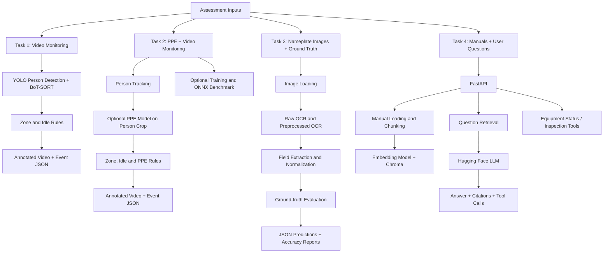
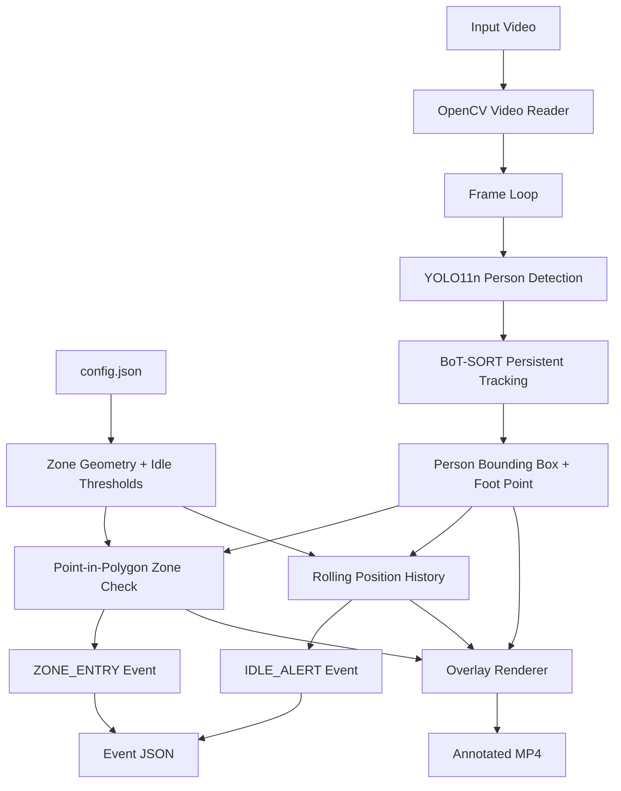
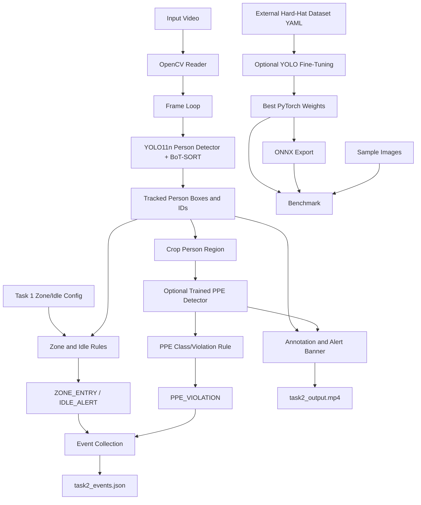
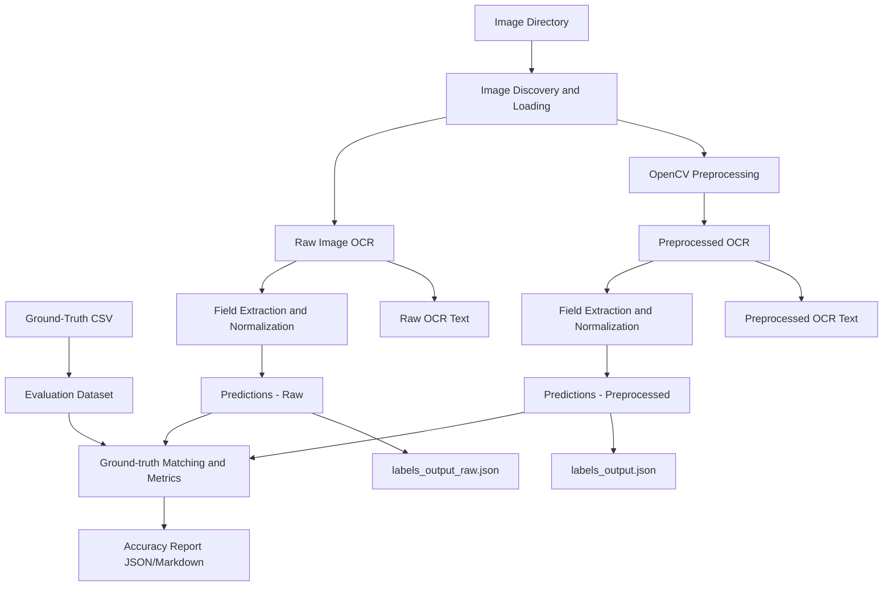
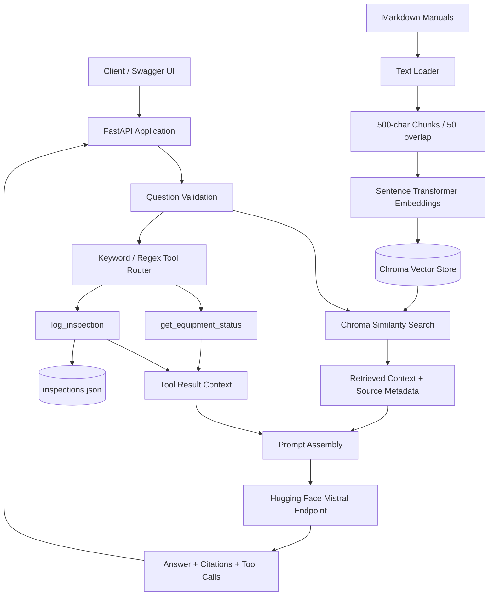
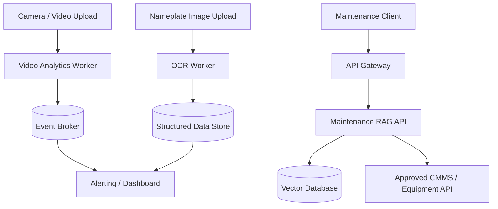

# System Design Document – AnjaLens AI/ML Practical Assessment

**Scope:** Four independently executable assessment tasks  
**Status:** Design description of the supplied implementation, with proposed production improvements clearly identified  
**Primary runtime:** Python

---

# 1. System Overview

The solution is a collection of four independent applications/prototypes:

1. **Task 1 – Worker Zone and Idle Monitoring:** video analytics for person tracking, restricted-zone entry and inactivity events.
2. **Task 2 – Integrated Worker Monitoring and PPE:** extends worker analytics with helmet/PPE detection and includes model training/evaluation and ONNX benchmarking functions.
3. **Task 3 – Equipment Nameplate OCR:** image-to-structured-data extraction with ground-truth evaluation.
4. **Task 4 – Maintenance RAG Assistant:** FastAPI service that retrieves passages from maintenance manuals, generates grounded answers, and exposes equipment/inspection helper tools.

The tasks share a Python/AI engineering theme but are not currently wired into one deployed platform. Each task has its own input, processing path and output artifacts.

## 1.1 High-level component view



---

# 2. Task 1 – Worker Zone Entry and Idle Monitoring

## 2.1 Purpose

Analyze a recorded factory-floor video to identify people, assign persistent track IDs, detect restricted-zone entry, detect prolonged inactivity and create reviewable evidence in the form of an annotated video and structured event log.

## 2.2 Architecture



## 2.3 Components

| Component | Responsibility |
|---|---|
| OpenCV reader | Opens video, reads frames and obtains FPS/dimensions |
| YOLO11n | Detects persons (class ID 0) |
| BoT-SORT | Associates detections across frames and supplies track IDs |
| Zone geometry | Converts normalized polygon vertices to pixel coordinates |
| Foot-point calculation | Uses bottom-center of each person box as the zone test point |
| Idle evaluator | Retains recent foot-point positions and calculates movement over the time window |
| Event collector | Creates `ZONE_ENTRY` and `IDLE_ALERT` records |
| Video writer | Writes visual overlays and alert banner to MP4 |
| JSON writer | Serializes the event list |

## 2.4 Data flow and rules

1. Read one frame at a time.
2. Run person detection and tracking.
3. For each track, calculate the bottom-center point `(center_x, y2)`.
4. If the point enters the configured polygon and the track was not already marked inside, emit one `ZONE_ENTRY` event.
5. Keep a rolling history of foot-point coordinates over the idle window.
6. Calculate maximum pairwise movement in that history. If it is below `pixel_distance` for approximately `time_seconds`, emit an `IDLE_ALERT`.
7. Draw the zone, bounding box, track ID, foot point and event banner.
8. At end of video, release resources and write events to JSON.

## 2.5 Configuration

- `zone_polygon_normalized`: polygon vertices in normalized video coordinates.
- `idle_rules.pixel_distance`: maximum pixel movement treated as idle.
- `idle_rules.time_seconds`: observation window for inactivity.

The supplied defaults are a rectangular zone spanning normalized coordinates `(0.3, 0.4)` to `(0.9, 0.9)`, a 30-pixel movement threshold and a 3-second time window.

## 2.6 Event data contract

```json
{
  "event_type": "ZONE_ENTRY",
  "track_id": 2,
  "timestamp": 4.99,
  "frame_number": 299,
  "box": [582.22, 232.64, 837.87, 965.25]
}
```

Supported event types: `ZONE_ENTRY`, `IDLE_ALERT`.

## 2.7 Operational considerations and risks

- Pixel-based idle thresholds vary with camera resolution, perspective and distance from camera.
- Tracking IDs can fragment during occlusion or detector misses.
- The zone test uses a foot point; camera calibration and site-specific zone drawing are required.
- Current event de-duplication is in-memory and tied to track IDs.
- Current code rewrites `config.json` with in-code defaults on each run.
- Current script's expected input folder is lowercase `video/`, while the supplied archive contains `Video/`; align the path before execution.
- The current implementation is batch/offline video processing, not a continuously running camera service.

## 2.8 Production target improvements

- Add CLI/config validation and preserve externally edited configuration.
- Use calibrated ground-plane distance or normalized movement for idle detection.
- Persist events incrementally to a database/message broker.
- Add event severity, camera ID, site ID, model version and UTC timestamp.
- Add monitoring for input stream failure, processing FPS and dropped frames.
- Evaluate detection/tracking accuracy against annotated test footage.

---

# 3. Task 2 – Integrated Worker Monitoring and PPE Compliance

## 3.1 Purpose

Combine person tracking, zone entry, inactivity monitoring and helmet/PPE violation detection in one video-processing pipeline. The code also provides optional YOLO fine-tuning/evaluation/export and PyTorch-versus-ONNX benchmarking functions.

## 3.2 Architecture



## 3.3 Components

| Component | Responsibility |
|---|---|
| Person detector/tracker | YOLO11n detection and BoT-SORT track association |
| Person cropper | Extracts each tracked person's image region |
| PPE detector | Runs trained helmet/no-helmet model on person crop |
| Zone evaluator | Tests foot point against configured restricted polygon |
| Idle evaluator | Evaluates rolling movement history |
| Event collector | Emits zone, idle and PPE events |
| Annotation/writer | Draws boxes, labels, polygon and writes MP4 |
| Training function | Fine-tunes YOLO11n on external hard-hat dataset |
| Benchmark function | Compares PyTorch and ONNX Runtime inference |

## 3.4 Processing sequence

1. Load Task 1 zone/idle configuration or use defaults.
2. Initialize the person tracker.
3. Load `hardhat_yolo11n.pt` when available.
4. Read a video frame and track persons.
5. Crop each tracked person and run PPE inference if the trained PPE weights exist.
6. Evaluate zone entry and idle rules.
7. Emit `PPE_VIOLATION` when the PPE model's predicted class indicates a no-helmet/head-related detection.
8. Annotate the video and write event records.

## 3.5 Events

Supported event types:

- `ZONE_ENTRY`
- `IDLE_ALERT`
- `PPE_VIOLATION`

The event structure includes event type, track ID, video timestamp, frame number and bounding box.

## 3.6 Model training and deployment path

The optional `train_and_evaluate()` routine expects a YOLO dataset YAML file and corresponding image/label directories. It trains YOLO11n, evaluates validation metrics, and exports ONNX. The optional `benchmark_models()` function compares latency/FPS on a sample image set.

These functions are defined in the source but the current script entry point calls only `run_integrated_pipeline()`. The training dataset is not part of the supplied archive.

## 3.7 Critical implementation limitation

If `hardhat_yolo11n.pt` is absent, the integrated pipeline does not execute PPE inference. `has_helmet` remains `True`, so no meaningful helmet violations are generated. The general person model is not a substitute for a trained PPE classifier. The provided `task2_events.json` therefore should not be interpreted as proof of PPE detection.

Before acceptance, provide the trained PPE model, confirm its class labels and class-ID mapping, and validate it on a held-out dataset.

## 3.8 Production target improvements

- Train and validate a dedicated PPE model; record dataset/model version and metrics.
- Apply confidence thresholds and temporal voting across frames.
- Define whether helmet absence is checked only when the head is visible.
- Add event cooldowns, per-track state expiration and reliable track re-identification.
- Persist events to a database or event stream.
- Add camera/site identifiers and alert delivery integration.
- Benchmark with fixed hardware, input resolution, warm-up and repeatable test images.

---

# 4. Task 3 – Equipment Nameplate OCR

## 4.1 Purpose

Convert equipment/nameplate images into structured equipment metadata and evaluate extraction quality against a supplied ground-truth CSV.

## 4.2 Architecture



## 4.3 Components

| Component | Responsibility |
|---|---|
| CLI parser | Accepts image, ground-truth, output and OCR engine paths/options |
| Image loader | Discovers and reads supported image files |
| OCR runner | Uses EasyOCR or Tesseract |
| Preprocessor | Applies image-processing operations before OCR |
| Field extractor | Maps OCR text into target fields |
| Normalizer | Cleans candidate field values |
| Evaluator | Compares predictions with ground truth |
| Report writer | Writes predictions, metrics, OCR text, processed images and logs |

## 4.4 Target fields

- `equipment_id`
- `serial_number`
- `model`
- `voltage`
- `manufacture_date`

## 4.5 Evaluation

The supplied report evaluates 15 images. It reports exact field accuracy both including null ground-truth fields and for non-null ground-truth fields. Serial-number character error rate (CER) is also reported.

Included baseline:

| Metric | Raw OCR | Preprocessed OCR |
|---|---:|---:|
| Field accuracy including nulls | 50.67% | 49.33% |
| Field accuracy for non-null ground truth | 17.50% | 15.00% |
| Aggregate serial-number CER | 0.7638 | 0.9606 |

The existing baseline does not show a gain from the current preprocessing path. It should be treated as an initial benchmark, not a production accuracy claim.

## 4.6 Output contract

- `labels_output_raw.json`
- `labels_output.json`
- `accuracy_report.json`
- `accuracy_report.md`
- raw and preprocessed OCR text by image
- preprocessed image artifacts
- execution log

## 4.7 Production target improvements

- Detect and rectify the nameplate region before OCR.
- Improve blur, glare, perspective and low-contrast handling.
- Use field-specific regex/format validators and confidence-aware extraction.
- Keep raw OCR text for auditability.
- Add per-field precision/recall, edit-distance examples and failure categories.
- Expand the dataset and create a fixed train/validation/test protocol.
- Track OCR engine, model versions, preprocessing configuration and runtime hardware.

---

# 5. Task 4 – Maintenance RAG Assistant and Tool API

## 5.1 Purpose

Expose a REST API for maintenance questions. The application retrieves relevant content from Markdown manuals, embeds and indexes it in Chroma, uses a Hugging Face-hosted language model to generate an answer, and includes citations. It also has simple equipment-status and inspection-logging helper tools.

## 5.2 Architecture



## 5.3 Components

| Component | Responsibility |
|---|---|
| FastAPI | HTTP routing and service lifecycle |
| Pydantic | Validates request and response schemas |
| Markdown loaders | Load local SOP/manual/safety documents |
| Text splitter | Creates 500-character chunks with 50-character overlap |
| Embedding model | `sentence-transformers/all-MiniLM-L6-v2` |
| Chroma | Stores vectors and source metadata |
| Retriever | Returns top 3 similar document chunks |
| Hugging Face Endpoint | Calls `mistralai/Mistral-7B-Instruct-v0.3` |
| Tool router | Keyword and regex based routing to helper functions |
| Equipment status tool | Returns mock status based on equipment ID |
| Inspection logger | Appends timestamped inspection records to JSON |
| Health endpoint | Reports LLM and vector-store initialization state |

## 5.4 Startup and request lifecycle

### Startup

1. Load environment variables.
2. Read `HUGGINGFACEHUB_API_TOKEN`.
3. Initialize the Hugging Face endpoint if the token exists.
4. Load Markdown manuals.
5. Split documents into chunks.
6. Create embeddings and initialize Chroma, or load an existing vector store.
7. Expose health state.

### Question request

1. Receive `POST /ask` with a question string.
2. Retrieve the top three semantically similar chunks.
3. Capture source metadata for citations.
4. Apply simple keyword detection to determine whether an equipment-status or inspection-log tool should run.
5. Add retrieved context and tool output to the prompt.
6. Invoke the language model.
7. Return answer, citations and tool-call details.

## 5.5 API contracts

### Health

`GET /health`

Response fields:
- `status`
- `llm_connected`
- `vectorstore_loaded`

### Ask

`POST /ask`

Request:

```json
{
  "question": "What is the maximum pressure for the Hydraulic Pump Model X-200?"
}
```

Response schema:

```json
{
  "answer": "string",
  "citations": ["pump_manual.md"],
  "tool_calls": []
}
```

## 5.6 Tool contracts and current behavior

- `get_equipment_status(equipment_id)` returns mock status, a fixed last-service date and optional mock alarm. The current implementation uses a simple even/odd numeric rule.
- `log_inspection(equipment_id, note, severity)` appends an ISO timestamp, equipment ID, note and severity to a JSON file.
- Tool routing is currently based on keyword checks and regular expressions. It is not native LLM function calling and may fail on alternate phrasing or malformed inputs.

## 5.7 Security, safety and reliability

- Keep the Hugging Face token in an environment variable or secret manager. Do not store it in source control.
- Protect `/ask` with authentication and rate limiting before exposing it outside a trusted local environment.
- Treat retrieved manuals as untrusted data and defend against prompt injection.
- Do not allow an LLM answer to authorize a physical equipment action. Require approved workflows and human confirmation.
- The status tool is mock logic and must not be used for real safety decisions.
- JSON-file inspection writes are not concurrency-safe or transactionally durable. Use a database with audit controls for production.
- Add request validation, error metrics, timeout/retry handling and health/readiness probes.

## 5.8 Production target improvements

- Use a database-backed equipment registry and inspection history.
- Integrate authenticated CMMS/SCADA/PLC APIs through explicit, allow-listed tools.
- Use typed tool schemas and explicit authorization for state-changing operations.
- Add retrieval score thresholds, reranking, document version metadata and re-indexing.
- Add answer-grounding evaluation, citation validation and a refusal path when evidence is insufficient.
- Separate liveness and readiness checks; include vector-store and model dependency status.

---

# 6. Cross-Cutting Design Considerations

## 6.1 Configuration and secrets

- Keep environment-specific configuration outside source code.
- Commit `.env.example` with variable names only, never actual secrets.
- Do not commit access tokens, passwords, private keys or credentials.
- Store model and dataset paths in configuration rather than hard-coding them.

## 6.2 Logging and observability

Recommended common fields:

- timestamp (UTC)
- task/application name
- run/request ID
- input identifier (video/image/equipment/document)
- model and configuration version
- processing duration
- status and error category

Avoid logging secrets or unnecessary personal data.

## 6.3 Testing strategy

| Layer | Suggested tests |
|---|---|
| Unit | Polygon membership, idle-window logic, event schema, field normalizers, tool routing |
| Integration | Video read/write, OCR end-to-end, Chroma retrieval, API response schema |
| Model evaluation | Detection precision/recall/mAP, tracking identity metrics, PPE confusion matrix, OCR field accuracy/CER, RAG groundedness |
| Regression | Fixed input videos/images/questions with versioned expected outputs |
| Operational | CPU/GPU startup, missing model/token, corrupt input, storage permission and dependency outage |

## 6.4 Deployment view (recommended, not present in the supplied code)

The current tasks are local scripts or a local API. A production deployment could package each task separately:



This is a target-state reference architecture, not a claim that the current assessment code already includes a message broker, gateway, database, dashboard or CMMS integration.

## 6.5 Known gaps to resolve before production acceptance

1. Task 1 video folder case mismatch and configuration overwrite behavior.
2. Task 2 missing trained PPE model and external training dataset; validate class mapping.
3. Task 3 low non-null field accuracy in the supplied baseline; improve extraction and evaluation.
4. Task 4 mock equipment status, local JSON inspection persistence, keyword-based tool routing and external LLM dependency.
5. Add repeatable setup instructions, automated tests, pinned compatible dependency sets and model/data versioning across all tasks.

---

# 7. Appendix – Supplied Repository Artifacts

| Task | Key source files | Key supplied data/artifacts |
|---|---|---|
| 1 | `Task_1/task_1.py` | `config.json`, `events.json`, `Video/worker-zone-detection.mp4`, YOLO weights and sample outputs |
| 2 | `Task_2/task_2.py` | `task2_events.json`, YOLO weights and sample output video |
| 3 | `Task_3/src/run_ocr_task3.py` | 15 nameplate images, `labels_ground_truth.csv`, generated OCR outputs and accuracy report |
| 4 | `Task_4/app/main.py`, `tools.py`, `utils.py` | Three Markdown manuals, `questions.json`, local Chroma data |

**Document note:** This design document describes the supplied source code and clearly distinguishes existing behavior from recommended target-state enhancements. Validate paths, model artifacts, package compatibility and credentials in the deployment environment before execution.
